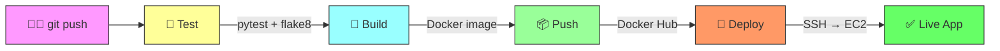
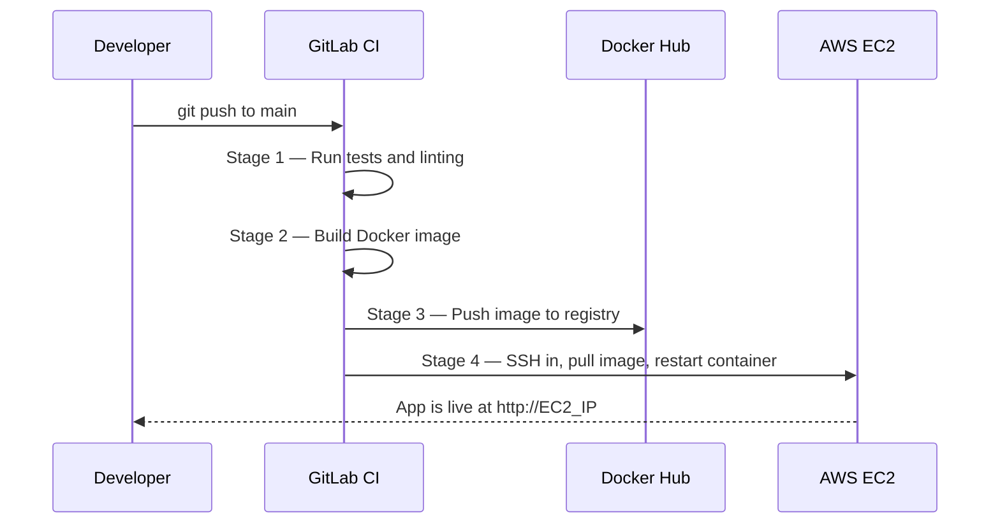

# CI/CD Pipeline: Flask API → Docker Hub → AWS EC2

[](https://gitlab.com/spaceman5789/gitlab-ci-ec2-deploy/-/pipelines)
[](https://gitlab.com/spaceman5789/gitlab-ci-ec2-deploy/-/pipelines)

A fully automated CI/CD pipeline that takes code from `git push` to a running application on AWS — with zero manual steps in between.

Every push to `main` triggers the full cycle: run tests → build Docker image → push to Docker Hub → deploy to EC2. The app is live within 2–3 minutes.

---

## How It Works



In simple terms: you change the code, push it, and the pipeline does everything else — tests the code, packages it into a Docker container, uploads the container to Docker Hub, connects to the server via SSH, and starts the new version.



---

## What Each Stage Does

### Stage 1: Test

Runs on every push to any branch. Installs dev dependencies, then runs two checks:

- **pytest** — runs unit tests and generates a coverage report (currently at 98%)
- **flake8** — checks code style and catches common Python mistakes

If either check fails, the pipeline stops. No broken code gets built or deployed.

### Stage 2: Build

Builds a Docker image using a multi-stage Dockerfile. The image is tagged with the commit SHA (a unique identifier tied to the exact code version) and `latest`. This means you can always trace back which code is running in production.

Also prints the image size so you can track optimization over time.

### Stage 3: Push

Uploads the built image to Docker Hub with three tags:

- `latest` — always points to the most recent build
- `commit SHA` — unique tag for traceability (e.g., `0ee194ed`)
- `branch name` — matches the Git branch (e.g., `main`)

There is also an optional manual job to push to AWS ECR (Amazon's own container registry).

### Stage 4: Deploy

Connects to the EC2 server via SSH and runs these commands:

1. Pull the new image from Docker Hub
2. Stop the old container (if running)
3. Remove the old container
4. Start a new container with the updated image

The `|| true` after stop/remove prevents the pipeline from failing on the first deploy when no container exists yet.

---

## Tech Stack

| Category | Technology | What it does |
|----------|-----------|--------------|
| App | Python 3.12, Flask, Gunicorn | REST API with CRUD operations |
| Containers | Docker, multi-stage build | Packages the app into a small, portable image |
| CI/CD | GitLab CI/CD | Automates the entire test → build → push → deploy cycle |
| Image Registry | Docker Hub | Stores versioned Docker images |
| Image Registry (opt.) | AWS ECR | Alternative registry, triggered manually |
| Server | AWS EC2 (eu-north-1) | Runs the production container |
| Networking | Elastic IP, Security Groups | Static IP address and firewall rules |

---

## Project Structure

```
gitlab-ci-ec2-deploy/
├── app/
│   ├── app.py                  # Flask application (REST API endpoints)
│   ├── requirements.txt        # Production dependencies
│   ├── requirements-dev.txt    # Dev dependencies (pytest, flake8, coverage)
│   └── tests/                  # Unit tests
├── .gitlab-ci.yml              # Full CI/CD pipeline (4 stages, 5 jobs)
├── Dockerfile                  # Multi-stage build for minimal image
├── docker-compose.yml          # Local development setup
├── Makefile                    # Shortcut commands (make build, make test, etc.)
├── .dockerignore               # Files excluded from Docker build context
└── README.md                   # This file
```

---

## How to Reproduce This Project

### Prerequisites

- An AWS account with an EC2 instance running Ubuntu and Docker installed
- A Docker Hub account with an Access Token (Read & Write permissions)
- A GitLab account

### Step 1 — Clone the repository

```bash
git clone https://gitlab.com/spaceman5789/gitlab-ci-ec2-deploy.git
cd gitlab-ci-ec2-deploy
```

### Step 2 — Set up CI/CD Variables in GitLab

Go to your repository → Settings → CI/CD → Variables. Add these:

| Variable | Value | Masked | What it is |
|----------|-------|--------|------------|
| `DOCKERHUB_USERNAME` | Your Docker Hub login | Yes | Used to log in and push images |
| `DOCKERHUB_TOKEN` | Docker Hub Access Token | Yes | Authentication token (not your password) |
| `EC2_HOST` | Your EC2 public IP | Yes | The server where the app will run |
| `EC2_USER` | `ubuntu` | No | SSH username (depends on your AMI) |
| `EC2_SSH_KEY` | Contents of your .pem file | Yes | Private key for SSH access to EC2 |

**Important:** if your `main` branch is not set as a protected branch in GitLab, do not mark these variables as "Protected" — otherwise they will be empty during pipeline runs.

### Step 3 — Prepare the EC2 instance

```bash
# Connect to your server
ssh -i your-key.pem ubuntu@YOUR_EC2_IP

# Install Docker
sudo apt update && sudo apt install docker.io -y
sudo usermod -aG docker $USER

# Log out and back in (so the docker group takes effect)
exit
ssh -i your-key.pem ubuntu@YOUR_EC2_IP

# Verify Docker works
docker run hello-world
```

### Step 4 — Open the right ports in Security Groups

In the AWS Console, go to EC2 → Security Groups → edit inbound rules:

| Port | Protocol | Source | Purpose |
|------|----------|--------|---------|
| 22 | TCP | Your IP | SSH access for deployment |
| 80 | TCP | 0.0.0.0/0 | HTTP traffic to the app |
| 443 | TCP | 0.0.0.0/0 | HTTPS (if SSL is configured) |

### Step 5 — Push to main and watch it deploy

```bash
git add .
git commit -m "feat: trigger CI/CD pipeline"
git push origin main
```

Go to GitLab → CI/CD → Pipelines. You will see the pipeline running through all 4 stages. In about 2–3 minutes, your app will be live at `http://YOUR_EC2_IP`.

---

## Security Considerations

### What is already in place

- **Credentials are stored in GitLab CI/CD Variables, not in code.** The Docker Hub token, SSH key, and server IP are encrypted and injected at runtime. They appear as `[MASKED]` in pipeline logs, so even if someone reads the logs they cannot see the actual values.

- **The SSH key only exists temporarily.** During the deploy job, the key is written to a file, used once, and discarded when the job container is destroyed. It is never persisted.

- **Docker Hub Access Token instead of password.** A scoped token with limited permissions (Read & Write) is used rather than the account password. If compromised, it can be revoked instantly without affecting the account.

- **Security Groups restrict access.** Only ports 22, 80, and 443 are open. SSH access can be further restricted to specific IP addresses.

- **Non-root user inside the container.** The Flask app runs as an unprivileged user, limiting the damage if the container is compromised.

### What could be improved in the future

- **OIDC authentication instead of static keys.** Replace long-lived AWS credentials with temporary tokens via OpenID Connect. Both GitLab CI and GitHub Actions support this. It eliminates the risk of leaked keys entirely.

- **Protected branches with merge request reviews.** Require code review before anything reaches `main`, so the deploy stage never runs on unreviewed code.

- **Container vulnerability scanning.** Add Trivy or GitLab Container Scanning to check images for known vulnerabilities before pushing them.

- **AWS Secrets Manager.** Store application secrets (database passwords, API keys) in Secrets Manager instead of environment variables.

- **Restrict SSH access to GitLab runner IPs only.** Instead of allowing SSH from any IP, whitelist only the IP ranges used by GitLab CI runners.

---

## Results

| Metric | Value |
|--------|-------|
| Full pipeline duration | ~2–3 minutes |
| Test coverage | 98% |
| Image size | Optimized via multi-stage build |
| Image tags | latest, commit SHA, branch name |
| Auto-deploy on push to main | Yes |
| Manual steps required | None |

---

## Lessons Learned

These are real problems I encountered while building this pipeline, and how I solved them:

**1. Variable names must match exactly.**
I named a variable `DOCKER_HUB_TOKEN` in the YAML file but `DOCKERHUB_TOKEN` in GitLab settings. The pipeline silently injected an empty string, and Docker login failed with a cryptic error. Always double-check that names in code and settings are identical, character by character.

**2. Protected variables only work on protected branches.**
I marked all variables as "Protected" in GitLab, but my `main` branch was not protected. The variables were empty during pipeline runs. Either protect the branch or uncheck the "Protected" flag on the variables.

**3. Docker Hub tokens need the right permissions.**
My first token had "Read-only" access. The image built successfully, but `docker push` failed with "insufficient scopes". The fix was creating a new token with "Read & Write" permissions.

**4. SSH username depends on the AMI.**
I tried connecting as `admin` to an Ubuntu instance and got "Permission denied". Ubuntu AMIs use `ubuntu`, Amazon Linux uses `ec2-user`, and Debian uses `admin`. Check your AMI before connecting.

**5. Use `|| true` to handle missing containers gracefully.**
On the first deploy, `docker stop flask-api` fails because the container does not exist yet. Adding `|| true` tells the pipeline to continue anyway. Without it, the entire deploy job fails on the very first run.

---

## Design Decisions

| Decision | Why |
|----------|-----|
| GitLab CI instead of GitHub Actions | To gain experience with both major CI/CD platforms; GitLab CI has a built-in container registry and Auto DevOps features |
| Docker Hub instead of ECR for auto-deploy | Simpler setup, no AWS credentials needed on the EC2 instance; ECR is available as an optional manual job |
| Alpine-based images for CI jobs | Minimal size means faster pull times and smaller attack surface |
| Commit SHA as image tag | Full traceability — you can always determine exactly which code is running in production |
| Single SSH key for deployment | Acceptable for a learning project; in production, use IAM roles with SSM Session Manager instead |

---

## Local Development

```bash
# Clone and enter the project
git clone https://gitlab.com/spaceman5789/gitlab-ci-ec2-deploy.git
cd gitlab-ci-ec2-deploy

# Run with Makefile shortcuts
make build    # Build the Docker image
make run      # Start the container
make test     # Run tests
make stop     # Stop the container

# Or use Docker Compose
docker-compose up -d
```


